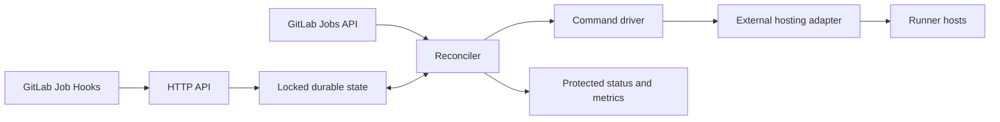

# Architecture

`cmd/gitlab-runner-controller` composes the service. `internal/config` validates
configuration, `internal/gitlab` observes jobs, `internal/state` owns persistence,
`internal/controller` schedules work, and `internal/httpapi` handles ingress.
`pkg/provider` defines the hosting contract and wire protocol. One generic
command driver invokes an external adapter; vendor SDKs, runner bootstrap,
executor selection, health checks, and drain mechanics belong in that adapter.

## Ownership and account binding

A stable controller ID, GitLab URL/project binding, provider name, pool name, and
slot index identify ownership. State cannot be reused with a different
controller or GitLab binding. Saved IDs and explicit adoption IDs are the only
existing resources the controller can mutate.

Before mutations, the adapter describes its stable account identity, endpoint or
region scope, lifecycle, and adapter revision. The expected account identity is
configured independently of credentials. Schema 1 state records account/scope
bindings; each reconciliation checks them again. Credential rotation cannot
silently redirect management to another account or scope. Duplicate aliases for
the same account/scope block both aliases before any mutation. One account uses
one configured lifecycle; simultaneous retained and disposable policies in that
account are unsupported.

The binding can change once no saved handles or unresolved operations remain.
Compatible adapter implementation upgrades can change the described revision
without changing the ownership binding.

Compute and location options and the pool's registered GitLab runner ID are
pinned while saved handles exist. Moving a pool or rebinding an account requires
an explicit migration or replacement workflow;
the controller does not probe a saved ID in a newly selected location.

Run one controller process per state directory on a local filesystem with working
file locks and atomic rename. The process holds the lock throughout its lifetime.
A second process fails startup. Separate directories do not coordinate ownership;
multiple controllers must not share runner tokens or manage the same resources.
Active-active scheduling would require a transactional shared store and
distributed fencing, beyond this service's local ownership model.

## Demand and capacity

Webhooks persist inbox hints and increase their revision. They never change
verified jobs. A complete GitLab active-job snapshot discovers pending,
preparing, running, and canceling jobs across every configured project.
Previously active jobs and new hinted jobs absent from that list are confirmed
through individual job requests before becoming inactive. An individual job 404
can remove a deleted job only after a complete, authorized 200 job listing for
that same project. A failed or unauthorized listing never clears known work.
Failed pages, unknown statuses, and malformed responses reject synchronization.

Every pending job tag must appear in a pool's runner tags. Untagged jobs are
excluded. Read-only runner metadata must confirm an unpaused registration with
the configured complete tag set; complete project runner listings must confirm
availability. Unknown metadata or permissions block pending scale-out. A runner's
offline, stale, or never-contacted status is expected for stopped pools and does
not establish ineligibility. Exactly one compatible pool receives pending
demand. An ambiguous match protects every compatible pool from stopping but
allocates no new instance. Use distinct selector tags in CI jobs to make their
destination explicit.

Preparing, running, and canceling jobs protect the pool identified by their
actual GitLab `runner.id`, regardless of later tag changes. Jobs assigned to
unrelated runners do not count. An active job without a known assignment
protects existing compatible capacity but never causes scale-out. Busy work is
never preempted by registration changes or a failed protected-job attempt.

Current branch/tag protection APIs and hooks cannot establish the pending job's
protected-runner eligibility. The default `probe_once` policy reserves one
durable attempt per runner and job before activating capacity. At most one
protected attempt is active per pool. Its budget starts only while a healthy,
ready manager has spare capacity, pauses when that opportunity disappears, and
expires only after a complete GitLab observation past the window with no newer
unverified hints. Exhaustion removes that job's pending demand: it cannot keep
idle hosts alive or recreate released hosts. The spent attempt survives restart,
hooks, and pool renaming. `strict` policy activates no capacity for unknown
protected eligibility. Status records the uncertainty and attempt outcome;
neither policy labels an unassigned job as proven eligible.

A synchronization commits only if the inbox revision is unchanged. Each new
lifecycle intent requires verified hints and no active backoff. Reconciliation
serializes external lifecycle calls while webhook ingestion continues. No network
call holds the state mutex. New hints invalidate further decisions until verified.
Adapter-side drain closes the race where a manager accepts a job after the last
GitLab observation.

The minimum refresh interval defers work without recording a reconciliation
failure. A pending hint does not degrade service readiness while the last
successful synchronization and reconciliation remain fresh; it still blocks
lifecycle changes. Deferred cycles preserve the previous reconciliation result
and completion time. A one-shot timer reconciles at the next eligible refresh
deadline alongside poll ticks and webhook wakes, honoring durable minimum
refresh and backoff timestamps. Racing hints retain their inbox entries and
retry at that deadline. Real failures and stale observations degrade readiness.

Pending demand determines scale-out:
`min(max_instances, ceil((pending + busy) / jobs_per_instance))`. Existing busy
instances count toward the target. Running jobs alone do not wake stopped hosts.
Higher priority wins available capacity; ties retain configuration order. An idle
pool can yield capacity immediately under pressure. Individual hosts in a busy
pool never scale in because the controller does not assume job-to-host attribution.

`max_running` is an operator-set count of concurrently consuming resources, not a
discovered subscription limit or a universal quota model. Inventory must cover
the complete bound account/scope, including unmanaged resources. Running and
unknown unmanaged resources consume capacity but are never mutated. Unresolved
creates and unconfirmed releases retain reservations. A provider's failure or
account backoff pauses only that account's adoption, observation, scheduling,
and external calls. Independent accounts continue; the reconciliation reports
combined errors and degraded readiness. Providers with additional quotas must
enforce them in the adapter and in operator policy.

## Durable lifecycles

| Lifecycle | Demand starts | Idle release | Capacity release |
| --- | --- | --- | --- |
| `retained` | Create or resume saved ID; observe running; persist; configure; check health | Persist drain progress, then stop saved ID | Later inventory explicitly reports stopped; ID remains saved |
| `disposable` | Create; await running without resume or persist; configure; check health | Persist drain progress, then destroy saved ID | Later complete current inventory confirms absence under the adapter's authoritative absence guarantee |

Creation intent, operation ID, and reservation are durable before the external
call. An interrupted or ambiguous create becomes unresolved and is never replayed
automatically. `resolve-create` requires an operator audit to bind the discovered
ID or confirm that no resource exists.

Disposable hosts never use resume, persist, or stop. A stopped disposable host
still exists and keeps its reservation until destruction is confirmed. A destroy
response alone cannot prove release. Persisted drain completion allows a lost
destroy reply to be recovered without asking a removed manager to drain again.
Missing inventory outside a requested destruction is unknown state, never
permission to forget, replace, or free a resource. The offline `release-missing`
command can release a known missing ID for either lifecycle after an explicit
operator audit, fresh bound inventory, private backup, and durable audit record.
It never mutates the provider. Unknown creation outcomes use `resolve-create`.

Shrinking a pool keeps saved slots. Extra slots release only when the entire
pool is idle. Removing a pool with active or unresolved resources fails startup.
A disposable pool cannot be removed while any saved ID remains, even if
inventory says stopped. Changing a saved pool's provider or lifecycle requires
deliberate migration.

State is a versioned complete JSON snapshot. Transactions clone and validate it,
write a private temporary file, synchronize it, atomically rename it, and
synchronize the parent directory before publishing it in memory. Persistence
failure poisons the store and stops the service. Restore usable storage before
restarting. The controller uses state schema version 1. Startup rejects
unsupported, unversioned, and incomplete snapshots without overwriting them.
Existing resources require [explicit adoption](migration.md)
when taking over from another controller.
An unchanged transaction does not advance the revision or write the snapshot.

## Runner configuration and process boundary

The global `runner` object and per-pool compute `options` are opaque JSON. The
controller sends runner name, GitLab URL, token, concurrency, runner options, and
configuration revision through JSON stdin. The adapter implements secure
bootstrap, ownership checks, health, and graceful drain for its runtime.

The revision includes runner configuration, pool options, and provider deployment
revision. Healthy running managers retain their deployed configuration until idle
release. Configuration changes apply to the next configured host without
interrupting live jobs. A retained adapter preserves manager identity across
stop/resume as part of its hosting contract.

Create, resume, adoption of a running host, and health loss start a persisted
readiness interval. Repeated `ready: false` observations do not extend its
deadline. After `readiness_timeout`, a host that still cannot configure becomes
a visible readiness failure with retry backoff. Running power state alone does
not mean the manager is ready, and this deadline never interrupts assigned work.

Commands execute directly without shell expansion. Only explicitly mapped
environment values and a safe process environment reach the child. Messages and
stderr are bounded; raw adapter output is excluded from diagnostics. Context
deadlines terminate the command's process group on supported Linux/macOS hosts.
See the [protocol](providers.md) for exact framing and adapter requirements.

Controller hosting is infrastructure configuration. The binary listens on
`PORT`, stores state under `STORAGE_DIR`, and handles termination signals. A
container host needs no special API integration with the controller.
Termination stops new dispatch while the current bounded adapter request can
finish and save its result. Forced cancellation follows the request and cleanup
budget; see [deployment](deployment.md) for the required host shutdown grace.
